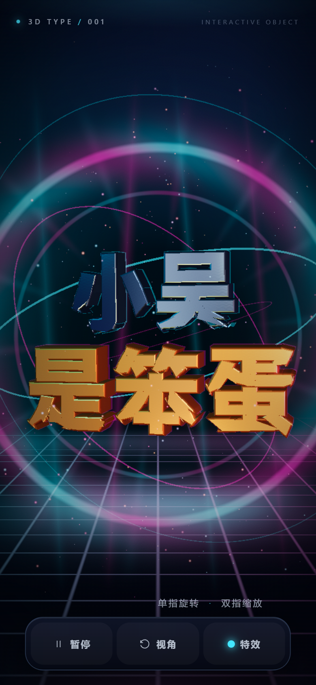
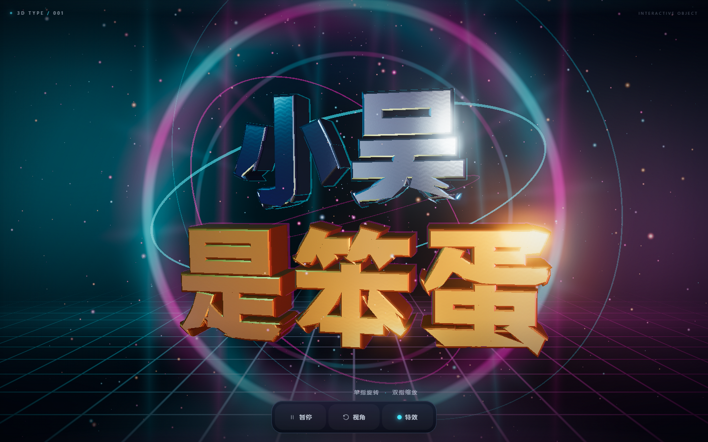

# 小吴是笨蛋 · 3D TYPE

一个面向安卓手机浏览器（Microsoft Edge / Chrome）的互动 3D 中文文字作品。



- 五个中文字全部由**带倒角的真实 3D 几何**构成，不是平面文字加阴影。
- 镀铬与黄金两套金属材质，使用程序化环境反射、拉丝法线、高光、窄角和动态灯光。
- 深空霓虹舞台：能量环、体积光束、粒子、网格地面、泛光和空间纵深。
- 手机竖屏优先：单指旋转、双指缩放、暂停/继续、恢复视角、切换特效。
- 无外部图片、无 CDN、无运行时字体下载；字体轮廓已作为几何数据内嵌在 `app.js` 中。

## 在线访问

**https://xbing9698-ai.github.io/xiaowu-3d-text/**

把网址直接发给对方即可。安卓 Microsoft Edge、Chrome、Safari 等现代手机浏览器打开后无需登录、无需安装 App、无需下载项目文件。



## 实际验证

已完成：

- 在 Chromium 移动设备模拟中按 `390 × 844`、`DPR 2`、触控模式打开页面。
- 通过 CDP 注入真实触摸事件：单指拖动旋转、双指捏合缩放均改变 3D 状态。
- 触摸底部按钮：暂停/继续、恢复视角、切换「霓虹 / 极光 / 省电」三档特效均正常。
- 横屏 `844 × 390` 重新布局验证，文字不会与底部按钮重叠。
- 验证页面不会因双指缩放文字而缩放整个网页（`visualViewport.scale = 1`）。
- 通过公网 HTTPS 地址用 Chromium / Edge 加载验证。
- 页面内容校验：`小吴是笨蛋` 五个字完整，5 个 3D 字符网格全部生成。

尚未完成：

- 没有真实的安卓手机 / 安卓版 Microsoft Edge 可供连接测试，因此无法测量具体机型、系统版本下的真实 FPS、发热和触控手感。已用同一 Chromium 内核的移动模拟与 CDP 触摸事件验证交互逻辑，但这不等同于真机验收。

## 操作

| 操作 | 效果 |
| --- | --- |
| 单指拖动 | 旋转文字（限制在可读范围内） |
| 双指捏合 | 缩放文字 |
| 暂停 / 继续 | 暂停所有动画；暂停后拖动仍可查看 |
| 视角 | 平滑恢复到默认构图 |
| 特效 | 循环切换霓虹 / 极光 / 省电；省电模式会关闭泛光并减少粒子 |

桌面端也支持鼠标拖动、滚轮缩放、双击恢复视角。

## 性能取舍

- 手机端渲染像素比上限 `1.55`，桌面端上限 `2`。
- 泛光在安静状态下使用半分辨率处理；省电模式直接关闭 bloom。
- 手机端粒子约 620 个，桌面端约 1150 个；省电模式降到 34%。
- 无实时阴影、无反射探针、无后处理景深，避免不必要的移动 GPU 压力。
- 暂停时模拟时间冻结，并且跳过整帧渲染，直到再次交互。

## 本地开发

```bash
npm install
npm run build
npm run serve
# 打开 http://127.0.0.1:4173/
```

`npm run build` 使用 esbuild 把 Three.js、字体轮廓数据和场景代码打包成 `app.js`。

## 文件结构

```text
index.html                  页面与手机 UI
styles.css                  响应式布局、加载页、按钮
app.js                      构建产物（部署用）
src/main.js                 3D 场景与触控交互源代码
src/font-data.json          五个字的字体轮廓数据
assets/NotoSansSC-Black-subset.ttf   字体子集（存档/授权用，运行时不加载）
assets/OFL-NotoSansSC.txt   字体授权
assets/LICENSE-THREE.txt    Three.js 授权
tools/make_font_data.py     从 TTF 生成轮廓数据的工具
tools/serve.mjs             本地静态服务器
```

## 字体与许可

- **Noto Sans SC Black**（weight 900），SIL Open Font License 1.1，Copyright 2014–2021 Adobe，Reserved Font Name “Source”。项目只提取「小吴是笨蛋」五个字的轮廓用于 3D 几何，并随附字体子集与完整 OFL 授权。
- **Three.js r160**，MIT License。
- 字体与 Three.js 的完整授权文本位于 `assets/`。
